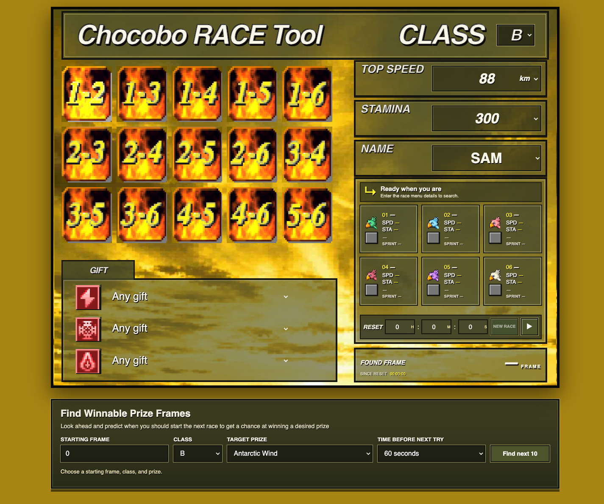

# PSX Computed Winner Lookup

This PSX-style race finder searches for a matching frame, then looks up cached long and short winners without launching DuckStation. Matching bet tiles receive `L` and `S` indicators.

Open the app at <https://ff7man.github.io/psxcomputed/>. Choose the race class, enter chocobo #1's speed, stamina, name, any known gifts, and time since reset, then search.

The bundled historical database currently contains actual wins only through about 7:01 after reset for Class C, 3:44 for B, 4:41 for A, and 5:29 for S. Results outside each class's imported data range are unavailable. The app does not simulate finishes or infer missing results. See the [source repository](https://github.com/ff7man/chocobo-betting/tree/main/psxcomputed) for the builder, database format, and update instructions.
