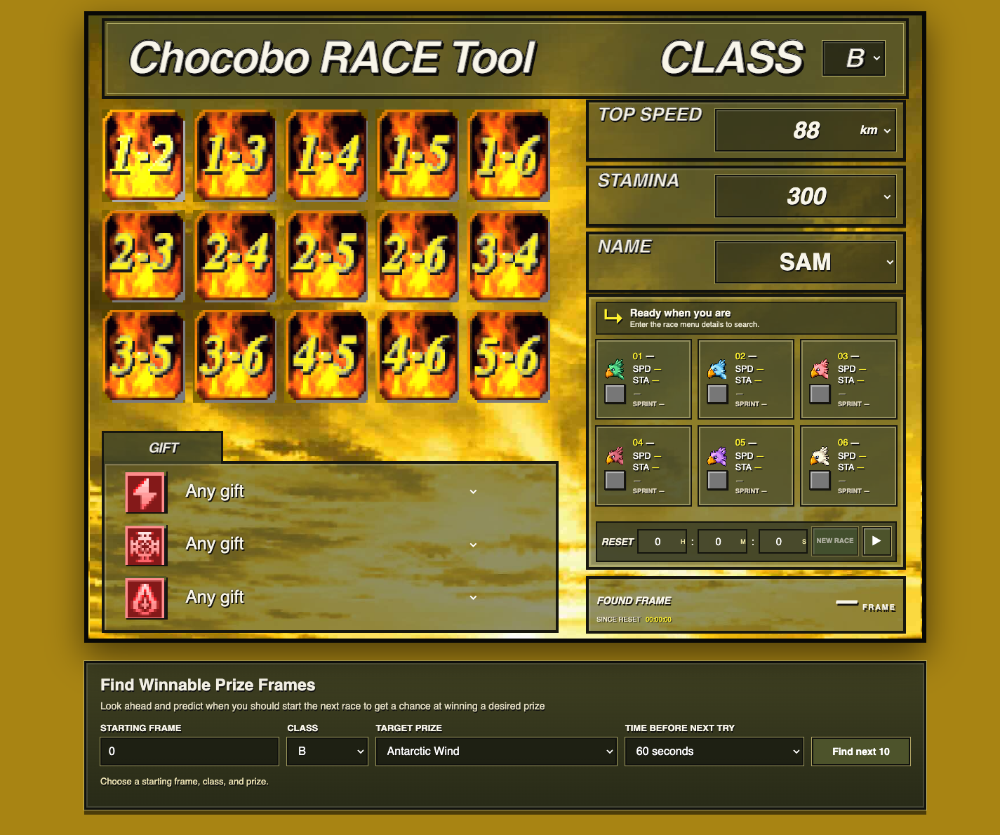

# PSX Computed Winner Lookup

This PSX-style race finder searches for a matching frame, then looks up cached
long and short winners without launching DuckStation. Matching bet tiles
receive `L` and `S` indicators.

Open the app at <https://ff7man.github.io/psxcomputed/>. Choose the race class,
enter chocobo #1's speed, stamina, name, any known gifts, and time since reset,
then search.

The frame counter is unsigned 32-bit and wraps after 2^32 (4,294,967,296)
frames, about 828 days at 60 fps. Searches wrap through the full cycle and pause
after every 5,184,000 searched frames (24 hours) to ask whether to continue.

The bundled winner database covers about the first hour of races, from frame
600 through frame 215,998. The game takes at least 10 seconds to reach the
betting screen, so frames 0–599 were intentionally omitted. Class C has short
race results; B, A, and S have both short and long results. Results outside the
available data range are unavailable; the app does not simulate finishes or
infer missing results. See the [source repository](https://github.com/ff7man/chocobo-betting/tree/main/psxcomputed)
for the builder, database format, and update instructions.
